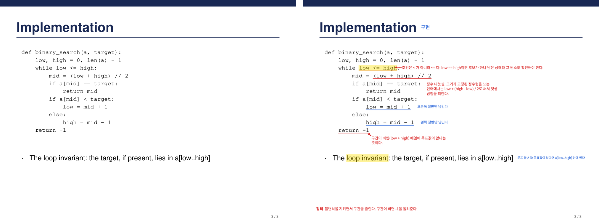

# annotate-lecture-pdf

영어 강의 슬라이드 PDF 위에 **번역(파랑)·필기(빨강)·형광펜(노랑)** 을 얹어 공부용 주석본을 만드는 에이전트 스킬입니다. 원본 PDF의 쪽 수, 쪽 크기, 글자는 그대로 두고 그 위에만 그립니다.

An agent skill that overlays translations (blue), study notes (red) and highlights (yellow) on lecture slide PDFs. The original pages stay intact; the agent writes a small per-page JSON spec and the bundled scripts find free space and draw. Docs are in Korean; the scripts work for any target language your font covers.



왼쪽이 원본, 오른쪽이 주석본입니다(`examples/`의 예제 슬라이드).

## 어떻게 동작하나

1. `prep.py`가 쪽마다 문단과 그림 영역에 id를 붙이고(`p1`, `r1` …) 쪽 이미지를 뽑습니다.
2. 에이전트가 슬라이드를 읽고 쪽별 명세를 씁니다. "문단 p3의 번역은 이것, 이 구절에 형광펜, 이 구절을 가리키는 필기는 이것" 같은 내용만 적습니다.
3. `render.py`가 쪽의 빈자리를 찾아 번역은 해당 줄 옆이나 아래에, 필기는 가리키는 대상 근처에 화살표와 함께 놓습니다. 놓지 못한 것은 경고로 알려 줍니다.
4. `check.py`가 주석본에서 원본 글자가 그대로 추출되는지, 쪽 수와 크기가 같은지 확인합니다.

좌표를 사람이 정하지 않아도 되는 것이 핵심입니다. 내용은 모델이 쓰고, 배치는 코드가 합니다.

## 설치

[Agent Skills](https://agentskills.io) 형식이라 스킬 폴더에 넣으면 됩니다.

```bash
# Claude Code
git clone https://github.com/Jaeyeong-CHOI/annotate-lecture-pdf ~/.claude/skills/annotate-lecture-pdf

# OpenClaw
git clone https://github.com/Jaeyeong-CHOI/annotate-lecture-pdf ~/.openclaw/workspace/skills/annotate-lecture-pdf
```

다른 에이전트도 스킬 폴더 위치만 다릅니다. Python 3.10 이상이 필요하고, [uv](https://docs.astral.sh/uv/)가 있으면 의존성은 실행할 때 자동으로 설치됩니다. uv가 없으면 `pip install -r requirements.txt`.

## 사용

에이전트에게 PDF를 주고 부탁하면 됩니다.

> 이 강의 PDF 주석본 만들어 줘. 번역하고 설명도 달아 줘.

에이전트가 [SKILL.md](SKILL.md)의 절차대로 진행합니다. 강의가 여러 개면 하나를 먼저 만들어 보여 주고 피드백을 받은 뒤 나머지를 만듭니다.

### 직접 돌려 보기

```bash
cd examples
uv run ../scripts/prep.py sample.pdf      # layout/sample.txt, img/sample/pNN.png
uv run ../scripts/render.py sample.pdf    # out/sample_주석.pdf, prev/sample/pNN.png
uv run ../scripts/check.py sample.pdf out/sample_주석.pdf
```

명세는 `examples/spec/sample/01.json`에 있습니다. 한 쪽은 이렇게 생겼습니다.

```json
{
 "1": {
  "tr": [{"p": "p2", "ko": "정렬된 배열에서 목표값을 찾는다"}],
  "hl": [{"t": "sorted array"}],
  "notes": [{"at": "sorted array", "ko": "정렬이 전제 조건이다. 정렬돼 있지 않으면 한쪽 절반을 버릴 근거가 없다."}],
  "sum": "정렬된 배열에서 가운데와 비교해 절반씩 버린다. 비교 횟수는 O(log n)."
 }
}
```

전체 형식은 [references/spec-format.md](references/spec-format.md), 글꼴·머리띠·글자 배율 같은 설정은 [references/settings.md](references/settings.md)에 있습니다.

## 구성

| 경로 | 내용 |
|---|---|
| `SKILL.md` | 에이전트가 읽는 절차와 내용 기준 |
| `references/spec-format.md` | 쪽별 명세 형식, 수식 표기, 경고 종류 |
| `references/settings.md` | 환경변수, 글꼴, 쪽 크기 보정, 한계 |
| `scripts/prep.py` | 문단·그림 영역 추출, 쪽 이미지 |
| `scripts/render.py` | 주석 배치와 그리기 |
| `scripts/sheets.py` | 여러 쪽을 한 장에 모은 검수 시트 |
| `scripts/check.py` | 원본 보존 검사 |
| `examples/` | 예제 슬라이드와 명세 |
| `tests/smoke.sh` | 예제로 전체 과정을 돌리는 검사 |

## 알아 둘 점

- 글자 층이 있는 PDF가 필요합니다. 스캔본은 먼저 OCR을 거쳐야 번역과 형광펜을 쓸 수 있습니다.
- 글자 크기 기준은 높이 540pt 슬라이드(PowerPoint 기본)에 맞춰져 있고, Beamer·Google Slides·Keynote처럼 쪽 크기가 다른 PDF는 자동으로 보정합니다.
- 한글 글꼴은 시스템에서 찾습니다(Noto Sans KR 권장). 없으면 PyMuPDF 내장 글꼴로 그립니다.
- 강의 자료에는 저작권이 있습니다. 주석본은 개인 학습용으로 쓰고, 원본을 배포할 권한이 없다면 주석본도 공유하지 마세요.

## 라이선스

스크립트와 문서는 [MIT](LICENSE)입니다. 실행에 쓰는 [PyMuPDF](https://pymupdf.readthedocs.io)는 AGPL-3.0(또는 상용 라이선스)이므로, 이 스크립트를 서비스나 제품에 넣어 배포할 때는 PyMuPDF의 조건을 확인하세요.
